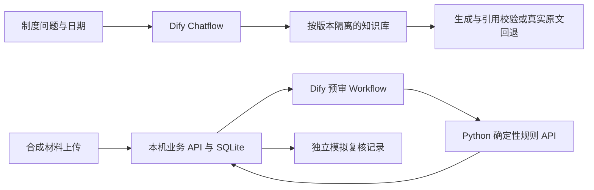

# 企业制度知识助手与报销材料预审系统

制度问答Chatflow第5版、预审Workflow第4版已在本地Dify运行；本机业务网页已接通材料上传、提取核验、规则报告与独立模拟复核记录。正式认证、严格独立评测与完整交付仍未完成。

目标：基于 Dify Chatflow / Workflow、Python API 与制度知识库，交付可引用的制度问答和可人工复核的差旅报销预审，重点展示完整 RAG、工作流工程、评测与可复现交付。

第一版使用合成制度、人员和报销材料，不执行真实付款、发票验真或财务审批。

## 安装与演示

新环境从[安装指南](docs/INSTALL.md)开始；无需模型账户的离线检查：

```powershell
python -m venv .venv
.\.venv\Scripts\python -m pip install -r requirements-dev.txt
.\.venv\Scripts\python -m unittest discover -s tests -v
.\.venv\Scripts\python tools/precheck_example.py data/examples/expense-001.json
```

本机演示入口：Dify `http://127.0.0.1:18080`、业务网页 `http://127.0.0.1:18082`。完整路线见[演示脚本](docs/DEMO.md)，私有配置只放`.local`，占位样例见config目录。



模型负责文本候选，服务端负责证据/字段核验，规则负责金额与材料问题；预审与人工复核记录分开。Dify平台、通义模型/embedding、向量库及框架是外部依赖。

## 源码交付

```powershell
.\.venv\Scripts\python tools/prepare_release.py
.\.venv\Scripts\python tools/verify_release.py .local/releases/source-<运行标识>.zip
```

工具生成带哈希清单的源码候选包并在新目录验证，不复制凭据、数据库或历史审核证据。见[交付范围及验证边界](docs/DELIVERY-001.md)。独立公开仓库：[xueyilan137-maker/enterprise-policy-rag](https://github.com/xueyilan137-maker/enterprise-policy-rag)。

原创代码和文档采用[MIT许可证](LICENSE)。Dify、模型插件及其他第三方依赖仍按各自许可证与服务条款使用，见[来源记录](docs/REFERENCES.md)。

## 继续项目

- [交接摘要](docs/HANDOFF.md)：新对话从这里开始。
- [项目进度](docs/PROGRESS.md)：已完成、进行中及验收标准。
- [设计方案](docs/DESIGN.md)：范围、架构、流程和评测。
- [设计决策](docs/DECISIONS.md)：取舍及未决事项。
- [问题记录](docs/ISSUES.md)：已知故障和避免重犯的方法。
- [参考仓库](docs/REFERENCES.md)：筛选结果、许可证和复用边界。

## 已有验证

Dify Cloud 经临时 SSH 隧道访问本机固定 JSON API：正确凭据 200、错误凭据 401，用户截图确认。临时隧道出现地址变化及连接重置，稳定性未通过，测试服务已终止。见 [联调记录](docs/tunnel-validation.md)。

已完成本地知识库、真实检索基线和问答闭环，见[第5版拒答修复与开发回归](docs/CHATFLOW-005.md)、[有界关联依据实验](docs/RETRIEVAL-EXPERIMENT-003.md)、[规则模块](docs/RULES-001.md)与[API/Workflow验收](docs/WORKFLOW-001.md)。尚无生产业务运行、正式效果指标或公网演示地址。

## 数据与工程验证

- 环境检查与运行路线：[ENVIRONMENT](docs/ENVIRONMENT.md)。
- 语料与真实检索评测准备：[RAG-BASELINE](docs/RAG-BASELINE.md)。
- 运行 `python tools/build_corpus.py` 生成两版本合成制度；安装requirements.txt到隔离.venv后，`.venv/Scripts/python -m unittest discover -s tests -v`运行工程测试。
- 当前118项工程测试通过（含交付包边界测试）；真实检索/问答验收单独记录，不将工程测试等同于模型效果。
- 当前第5版DSL使用`python tools/build_chatflow_candidate.py --transport-routing --evidence-fallback`生成；旧build_chatflow.py保留冻结第4版。详见CHATFLOW-005，公开模板不含本机知识库ID。
- `python tools/precheck_example.py data/examples/expense-001.json`运行合成申请离线预审，不调用模型或服务。

规则服务启动、网络范围、凭据保存与真实HTTP验证见[WORKFLOW-001](docs/WORKFLOW-001.md)。[正式后端API验收](docs/WORKFLOW-002.md)、[单申请持久化与身份隔离](docs/BUSINESS-001.md)、[CSV解析](docs/MATERIALS-001.md)、[模型提取核验](docs/EXTRACTION-001.md)与[格式修复](docs/EXTRACTION-002.md)均保留实际记录。

[业务网页与独立复核](docs/WEB-001.md)入口为[本机工作台](http://127.0.0.1:18082/)，使用`tools/business_local.ps1 -Action Start`启动既有单worker服务。选择员工或财务视角演示，任何本机访客可切换，不能当作正式登录。复核是自动化合成联调，不是财务真人审核；正式认证、OCR、跨申请历史查重与独立评测未实现。

[前瞻性评测准备](docs/EVALUATION-001.md)已冻结8问答+8申请并披露开发场景重叠；[首轮结果](docs/EVALUATION-002.md)记录用户标签审核后真实材料/检索/发布问答，以及随后用户统一批量回答评分。材料8/8匹配固定检查、检索Recall@3=0.875、发布问答有5个统一拒答；不把这些数字或批量评分称为客观答案准确率，失败记录保持。
